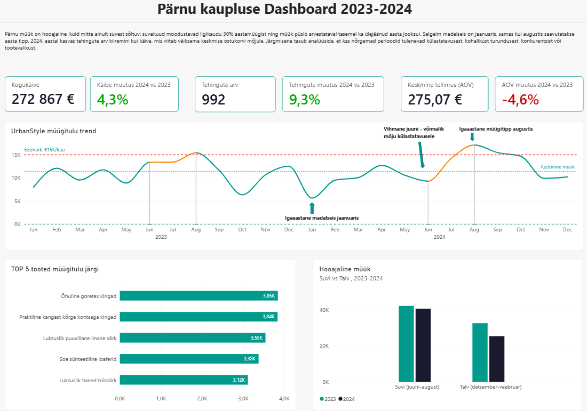

# Rene Bubõr · DACA andmeanalüüsi portfoolio

**Finants- ja ärianalüüs | Excel · Power BI · SQL · Python**

Ühendan finantsanalüüsi ja juhtimisaruandluse kogemuse DACA programmis arendatud SQL-i ja Pythoni oskustega. Siin näitan, kuidas uurin andmekvaliteeti, koostan analüüse ning muudan korduva andmetöötluse korratavaks töövooks.

UrbanStyle on DACA programmi õppejuhtum. Siinsed tulemused kirjeldavad õppeandmestikku; soovitused ei ole tõend tegelikus ettevõttes saavutatud ärimõjust.

## Alusta nendest töödest

| Töö | Äriküsimus ja väljund | Minu panus |
|---|---|---|
| [Pärnu kaupluse müügiandmelugu](week-6/README.md) | Kuidas esitada hooajalisust ja müügitulemusi juhtimisotsuste toetamiseks? Power BI vaade ja juhtimiskokkuvõte. | Asukohapõhine analüüs ja visualiseerimine. |
| [Kliendiandmete laadimine ja RFM-analüüs](week-7/README.md) | Kuidas valmistada kliendi- ja müügiandmed ette ostukäitumise analüüsiks? CSV ja Supabase töövihikud. | Meeskonnas andmete laadimine ja puhastamine; individuaalselt kogu analüüsi läbimine. |
| [Automatiseeritud analüüsipipeline](week-8/README.md) | Kuidas teha müügiandmete töötlemine ja raportite loomine korratavaks? Python, KPI-d ja ekspordid. | Meeskonnas transformatsioonid; individuaalselt kogu pipeline. |
| [SQL andmekvaliteedi analüüs](week-2/README.md) | Kuidas leida ja kontrollitult parandada kliendiandmete probleeme? SQL-päringud ja puhastuslogi. | Kliendiandmete uurimine ning paranduste katsetamine. |

### Power BI näidis

[Vaata PDF-i](week-6/individual/urbanstyle_dashboard_export.pdf) · [Loe järeldusi](week-6/individual/week6_executive_summary.md)

## Tööd nädalate kaupa

| Nädal | Teema |
|---|---|
| [0](week-0/README.md) | Töökeskkonna seadistamine |
| [1](week-1/README.md) | Müügiandmete esmane uurimine SQL-iga |
| [2](week-2/README.md) | Andmekvaliteet ja puhastamine |
| [3](week-3/README.md) | Tabelite ühendamine ja laoanalüüs |
| [4](week-4/README.md) | Agregatsioonid ja turundusanalüüs |
| [5](week-5/README.md) | Power BI dashboard |
| [6](week-6/README.md) | Andmelugu ja juhtimisvaade |
| [7](week-7/README.md) | Python, pandas ja RFM |
| [8](week-8/README.md) | API ja automatiseeritud pipeline |
| [9](week-9/README.md) | Värbamisjuhend personalijuhi vaatest |
| [10](week-10/README.md) | Tervikportfoolio korrastus ja esitluse ettevalmistus |

Iga nädala `individual/` sisaldab minu individuaalseid väljundeid. `team/` sisaldab meeskonnatöö konteksti ja viiteid ühisele tööle. Täpne vastutus on kirjeldatud vastava nädala README-s.

## Tööriistad

- **Excel ja Power BI:** juhtimisaruandlus, andmemudelid ja visualiseerimine.
- **SQL ja PostgreSQL / Supabase:** andmete uurimine, ühendamine, puhastamine ja koondamine.
- **Python:** pandas, API-päringud, Plotly ja modulaarne andmetöötlus.
- **Git ja GitHub:** lähtekood, dokumentatsioon ja versioonihaldus.

## Kuidas töid vaadata

Alusta README-st ja ekraanipiltidest; PDF-e saab vaadata ilma Power BI-ta. `.pbix` failid vajavad Power BI Desktopi. Python-tööde käivitamine eeldab sobivat keskkonda ning Supabase-tööde puhul enda ligipääsuandmeid. Täpsemad juhised on nädalate README-des.

## AI kasutamine

Kasutasin AI-d SQL-i ja Pythoni selgitamiseks, vigade leidmiseks ning dokumentatsiooni struktureerimiseks. Konkreetsem kasutus ja tulemuste kontrollimine on kirjeldatud vastavate nädalate README-des. AI soovituste sobivust tuleb hinnata lähtekoodi, andmete ja tegelike käivitustulemuste põhjal.

[GitHubi profiil](https://github.com/renebubor)
